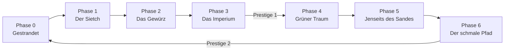
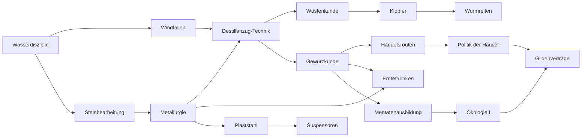

# 01 – Konzept & Spielmechaniken

> **Hinweis zu Zahlen:** Alle Werte in diesem Dokument sind **Startwerte für das Balancing**, keine finalen Werte.
> **Hinweis zu Begriffen:** *Dune*-Begriffe (Gewürz, Sietch, Gilde, Mentat …) werden hier der Lesbarkeit halber verwendet. Im Code laufen alle Namen über eine austauschbare **Namensschicht** (siehe [02-story.md, Abschnitt 1](02-story.md#1-rechtlicher-rahmen-und-kanon-nähe)).

---

## 1. Genre-Einordnung (Taxonomie)

**Oberbegriff:** Videospiel → Genre-Familie *Simulation / Strategie* → **Incremental Game** (oft synonym: „Idle Game“).

Die beiden Begriffe überschneiden sich, betonen aber Unterschiedliches:

- **Incremental:** Zahlen wachsen schrittweise; Erträge werden reinvestiert, um die Ertragsrate zu steigern. Kernprinzip: *exponentiell wachsende Erträge gegen exponentiell wachsende Kosten*.
- **Idle:** Fortschritt läuft ohne Eingaben weiter, oft auch bei geschlossenem Spiel (Offline-Fortschritt).

| Unterart | Kern | Beispiele |
|---|---|---|
| Clicker | Aktives Klicken ist Haupteinnahmequelle | Cookie Clicker (Frühphase), Clicker Heroes |
| Reine Idle-/Tycoon-Spiele | Kaufen und Warten, wenige Systeme | AdVenture Capitalist |
| **Ressourcen-Management-Incrementals** („Kittens-likes“) | Viele verzahnte Ressourcen, Lagergrenzen, Berufe, Forschungsbaum, Jahreszeiten | **Kittens Game**, Evolve, teilweise Trimps |
| **Narrative / Entdeckungs-Incrementals** | Das Spiel enthüllt sich schrittweise; die Geschichte wird über Mechaniken erzählt | **A Dark Room**, Candy Box, **Universal Paperclips**, Spaceplan |
| Prestige-Schichten-Spiele | Mehrere Reset-Ebenen, Zahlen weit jenseits von 10³⁰⁸ | Antimatter Dimensions, Realm Grinder |
| RPG-Incrementals | Charakterwerte, Kampf, Skills | Melvor Idle, Progress Knight, NGU Idle |

**Nachbargenres:** Aufbausimulation (Anno), Fabrik-/Automatisierungsspiele (Factorio), 4X-Strategie, Management-Simulation.

**Einordnung dieses Projekts:** Hybrid aus *Ressourcen-Management-Incremental* (mechanisches Gerüst nach Kittens Game) und *narrativem Entdeckungs-Incremental* (Erzählweise nach A Dark Room und Universal Paperclips).

---

## 2. Leitprinzipien

1. **Idle zuerst, aktiv als Bonus.** Wer nichts tut, kommt voran; wer aktiv spielt, kommt schneller voran. Kein aktives Ereignis ist Pflicht.
2. **Kein Game Over.** Verluste sind begrenzt (Prozentanteile, abwandernde Bewohner, verlorene Fahrzeuge) – nie ein Totalverlust.
3. **Wasser ist alles.** Die zentrale Knappheit ist Wasser, nicht Geld. Das trägt das Thema des Settings.
4. **Gewürz ist Macht und Gift.** Gewürz ist die wertvollste Ressource, erzeugt aber Abhängigkeit, Bedrohung und einen ökologischen Zielkonflikt.
5. **Progressive Enthüllung.** Start mit einem einzigen Knopf. Jedes System erscheint erst, wenn die Geschichte es einführt.
6. **Mechanik erzählt Geschichte.** Phasenwechsel = Aktwechsel. Story-Entscheidungen haben mechanische Folgen.
7. **Nachvollziehbare Zahlen.** Jede Rate ist per Tooltip in ihre Bestandteile aufschlüsselbar (Kittens-Prinzip).
8. **Story blockiert nie die Simulation.** Entscheidungsdialoge pausieren das Spiel nicht; offene Entscheidungen warten, bis der Spieler da ist.

---

## 3. Spielschleifen

| Schleife | Zeitskala | Ablauf |
|---|---|---|
| Kernschleife | Sekunden – Minuten | Ressourcen sammeln → Gebäude bauen / Berufe zuweisen → höhere Rate → Lager voll → Lager ausbauen oder veredeln |
| Mittlere Schleife | Stunden – Tage | Forschung → neue Gebäude, Berufe, Upgrades → neue Ressourcen → nächster Story-Akt |
| Meta-Schleife | Tage – Wochen | Generation beenden (Prestige) → Ahnenerinnerung → Blutlinien-Merkmale → schneller durch frühe Phasen → weiter kommen als zuvor |

---

## 4. Phasenübersicht

| Phase | Akt | Neue Systeme | Zentrale Knappheit | Zieldauer (1. Generation) |
|---|---|---|---|---|
| 0 – Gestrandet | Prolog | Klick-Aktionen (Tau sammeln, Wrack durchsuchen), Behelfs-Destillanzug, eigener Wasserverbrauch | Wasser | 5–10 min |
| 1 – Der Sietch | Akt I | Bevölkerung, Berufe, Gebäude, Lager, Forschung, Kalender | Wasser, Wohnraum | 1–3 h |
| 2 – Das Gewürz | Akt II | Gewürz, Werkstatt-Vertiefung, Erntefabriken, Würmer, Expeditionen, Handel | Metall, Destillanzüge | 1–2 Tage |
| 3 – Das Imperium | Akt III | Legende (≙ Glaube), Einfluss (≙ Kultur), Fraktionen, Tribut, Bedrohung/Verteidigung, Mentaten | Einfluss, Sicherheit | 3–6 Tage |
| *– erste Generation endet sinnvoll (Prestige-Ebene 1) –* | | | | |
| 4 – Grüner Traum | Akt IV | Ökologie: Feuchtigkeit, Wurmpopulation, Pflanzungen | Balance Wasser ↔ Gewürz | 2.–3. Generation |
| 5 – Jenseits des Sandes | Akt V | Gilde, Kontrakte, Außenwelten | Lieferfähigkeit Gewürz, Solari | spätere Generationen |
| 6 – Der schmale Pfad | Epilog | Enden, Prestige-Ebene 2, Prüfungen, volle Automatisierung | Vorsehung | Endgame |



---

## 5. Ressourcen

### 5.1 Grundressourcen

| Ressource | Kategorie (Kittens-Entsprechung) | Hauptquelle | Hauptverwendung | Lager-Gebäude | ab Phase |
|---|---|---|---|---|---|
| **Wasser** | Lebensgrundlage (≙ Katzenminze) | Klick „Tau sammeln“, Taufänger, Windfalle, Wasserhüter | Verbrauch durch Bevölkerung, Bau, Pflanzungen | Zisterne | 0 |
| **Schrott** | Baumaterial (≙ Holz) | Klick „Wrack durchsuchen“, Bergungstrupp, Expeditionen | Bau, Veredelung zu Metall | Lagerhöhle | 0 |
| **Fels** | Baumaterial (≙ Mineralien) | Steinmetz | Bau | Lagerhöhle | 1 |
| **Fasern** | Baumaterial | Fasersammler (Wüstengewächse), später Pflanzungen | Gewebe, Destillanzüge | Lagerhöhle | 1 |
| **Erkenntnis** | Forschung (≙ Wissenschaft) | Gelehrte, später Mentaten | Forschung | Archiv / Lehrraum | 1 |
| **Ausdauer** | Aktionsressource (≙ Katzenkraft) | Sandläufer | Expeditionen, Wurmreiten | – (feste Obergrenze, durch Upgrades erhöht) | 1 |
| **Gewürz** | Kern- und Luxusressource | Gewürzsucher, Erntefabrik, Gewürzeruption | Handel, Moral, Visionen, Gilde | Gewürzsilo | 2 |
| **Solari** | Währung | Handel | Kauf, Bestechung, Tribut | Tresorkammer | 2 |
| **Legende** | Glaube (≙ Faith) | Priesterinnen (Sayyadina), Rituale | Prophezeiungs-Upgrades | Gebetsraum (erhöht Obergrenze) | 3 |
| **Einfluss** | Kultur (≙ Culture) | Ratshalle, Diplomaten | Politik, Fraktionsbeziehungen | Ratshalle | 3 |

### 5.2 Ökologische Kennzahlen (keine sammelbaren Ressourcen)

| Kennzahl | Bereich | Wirkung |
|---|---|---|
| **Feuchtigkeit** (planetar) | 0–100 % | Erhöht Wasserertrag, senkt Wurmpopulation |
| **Wurmpopulation** (relativ) | 0–100 % | Multiplikator auf alle Gewürzerträge |
| **Bedrohung** | 0–∞ | Auslöser für Überfälle (siehe Abschnitt 15) |

### 5.3 Handwerksgüter (Werkstatt)

| Gut | Rezept (Startwert) | Verwendung |
|---|---|---|
| Metall | 100 Schrott | Bau ab Phase 1 |
| Gewebe | 50 Fasern | Destillanzüge, Zelte, Filmbücher |
| **Destillanzug** | 2 Gewebe + 1 Metall + 20 Wasser | **Jede Person in einem Wüstenberuf benötigt einen Anzug** (Sandläufer, Gewürzsucher) – harte, thematische Begrenzung |
| Klopfer | 5 Metall + 2 Gewebe | Wurmreiten; Ablenkung bei Wurmzeichen |
| Crysmesser | 1 Wurmzahn (Expeditionsfund) + 10 Legende | Voraussetzung für Kämpfer (Fedaykin), Rituale |
| Filmbuch (≙ Manuskript) | 5 Gewebe + 50 Erkenntnis | Erhöht Erkenntnis-Obergrenze, Einfluss-Upgrades |
| Plaststahl | 10 Metall + 100 Erkenntnis | Bau ab Phase 3 |
| Gewürzkonzentrat | 100 Gewürz | Gilden-Handel, Visionen |
| Blaupause | Handel mit Technokraten oder 5 000 Erkenntnis | Späte Upgrades |

Handwerks-Effizienz: `Ertrag = Rezeptmenge × (1 + 0,05 × Werkstätten + Upgrade-Boni)`.

---

## 6. Bevölkerung, Berufe, Moral

### 6.1 Bevölkerung

- **Verbrauch:** 0,15 Wasser/s pro Person.
- **Wachstum:** Wenn freier Wohnraum vorhanden **und** Wasserbilanz > 0 → +1 Person alle 30 s (verkürzt durch Moral > 100 %).
- **Mangel:** Wasser = 0 bei negativer Bilanz → nach 10 s Karenz verlässt 1 Person den Sietch (Log-Text, kein Game Over).
- **Wohnraum:** über Gebäude (Höhlenkammer, Sietch-Erweiterung, Tiefer Sietch).

### 6.2 Berufe

| Beruf | Ertrag (Startwert) | Voraussetzung | Phase |
|---|---|---|---|
| Wasserhüter | +0,5 Wasser/s | – | 1 |
| Bergungstrupp | +0,15 Schrott/s | – | 1 |
| Steinmetz | +0,3 Fels/s | Forschung „Steinbearbeitung“ | 1 |
| Fasersammler | +0,2 Fasern/s | – | 1 |
| Gelehrter | +0,2 Erkenntnis/s | Lehrraum | 1 |
| Sandläufer | +0,1 Ausdauer/s | 1 Destillanzug | 1–2 |
| Gewürzsucher | +0,1 Gewürz/s | 1 Destillanzug, „Gewürzkunde“ | 2 |
| Handwerker | +5 % Handwerks-Effizienz je Person; später Auto-Handwerk | Werkstatt | 2 |
| Priesterin (Sayyadina) | +0,05 Legende/s | Akt III | 3 |
| Kämpfer (Fedaykin) | +2 Verteidigung | 1 Crysmesser | 3 |
| Mentat | ×-Bonus auf Erkenntnis, schaltet Automatisierung frei | Mentatenschule | 3 |
| Planetologe | +Feuchtigkeit/s | Akt IV | 4 |

Ein Wasserhüter versorgt damit ca. 3,3 Personen – genau dieser Engpass trägt Phase 1.

### 6.3 Moral (≙ Zufriedenheit in Kittens Game)

- Basis 100 %, wirkt **multiplikativ auf alle Produktion**, Bereich 50–150 %.
- −2 % je Person über 5 (Enge im Sietch).
- +10 % je verfügbarem Luxusgut (Gewürzration, später Kaffee, Musik/Filmbücher).
- Story-Flags und Legende-Upgrades als weitere Modifikatoren.

---

## 7. Gebäude

Kostenformel: `Kosten(n) = Basiskosten × Faktor^n` (n = Anzahl bereits gebauter Exemplare).

### Phase 0–1

| Gebäude | Basiskosten | Faktor | Effekt |
|---|---|---|---|
| Taufänger | 10 Schrott | 1,12 | +0,05 Wasser/s; in der Glutzeit −50 % |
| Windfalle | 50 Schrott, 20 Fels | 1,15 | +0,4 Wasser/s; in der Sturmzeit +30 % |
| Zisterne | 40 Fels | 1,25 | +200 Wasser-Lager |
| Höhlenkammer | 25 Fels | 1,5 | +2 Wohnplätze |
| Lagerhöhle | 30 Fels | 1,25 | +150 Lager für Fels, Schrott, Fasern |
| Lehrraum | 25 Fels, 10 Fasern | 1,15 | +10 % Erkenntnis, +200 Erkenntnis-Lager |
| Werkstatt | 100 Fels, 50 Schrott | 1,15 | Erste schaltet Werkstatt-Tab frei; je +5 % Handwerks-Effizienz |

### Phase 2

| Gebäude | Basiskosten | Faktor | Effekt |
|---|---|---|---|
| Gewürzsilo | 100 Metall | 1,2 | +500 Gewürz-Lager |
| Schmugglerposten | 200 Fels, 50 Metall | einmalig | Schaltet Handel frei |
| Tresorkammer | 150 Fels, 30 Metall | 1,2 | +1 000 Solari-Lager |
| Erntefabrik | 500 Metall, 200 Solari | 1,18 | +2 Gewürz/s; **Wurmrisiko** |
| Carryall-Hangar | 300 Metall, 100 Plaststahl | 1,2 | Rettet je 1 Erntefabrik pro Wurmzeichen |
| Sietch-Erweiterung | 200 Fels, 50 Metall | 1,3 | +4 Wohnplätze |

### Phase 3

| Gebäude | Effekt |
|---|---|
| Ratshalle | +Einfluss/s, Einfluss-Lager |
| Gebetsraum | Legende-Obergrenze, +Moral |
| Mentatenschule | Mentaten-Beruf, Automatisierungs-Slots |
| Wachposten / Verborgene Eingänge | +Verteidigung bzw. −Sichtbarkeit (senkt Bedrohung) |
| Tiefer Sietch | +8 Wohnplätze (Plaststahl) |

### Phase 4–5

| Gebäude | Effekt |
|---|---|
| Pflanzstation | +Feuchtigkeit, +Fasern |
| Qanat (unterirdischer Kanal) | großes Wasserlager, +Feuchtigkeit |
| Dünenanker (Grasbepflanzung) | stabilisiert Dünen → weniger Sturmschaden |
| Raumhafen | Gilden-Kontrakte |
| Außenposten (je Außenwelt) | weltspezifische Ressource |

---

## 8. Forschung

Kosten steigen je Stufe etwa um den Faktor 3–5. Forschung verbraucht Erkenntnis (und später zusätzliche Güter wie Filmbücher oder Blaupausen).

| Forschung | Kosten (Startwert) | Schaltet frei |
|---|---|---|
| Wasserdisziplin | 30 Erkenntnis | −10 % Wasserverbrauch, Windfallen-Forschung |
| Steinbearbeitung | 40 | Steinmetz |
| Windfallen | 60 | Windfalle |
| Metallurgie | 150 | Metall herstellen |
| Destillanzug-Technik | 100 + 10 Metall | Destillanzüge, Sandläufer |
| Wüstenkunde | 250 | Expeditionen, „Sandgang“-Upgrade (weniger Wurmverluste) |
| Gewürzkunde | 300 | Gewürzsucher, Gewürzsilo |
| Klopfer | 500 | Klopfer |
| Handelsrouten | 800 | Schmugglerposten, Handel |
| Erntefabriken | 1 500 | Erntefabrik |
| Wurmreiten | 2 000 + Story-Flag | Schnellere Expeditionen, Region „Tiefe Wüste“ |
| Plaststahl | 5 000 | Plaststahl, Tiefer Sietch |
| Suspensoren | 8 000 | Carryall-Hangar |
| Politik der Häuser | 6 000 + Einfluss | Fraktionen, Tribut-Verhandlung |
| Mentatenausbildung | 10 000 | Mentatenschule |
| Ökologie I–IV | 25 000 → … | Pflanzstation, Qanat, Dünenanker |
| Gildenverträge | 100 000 | Raumhafen |



---

## 9. Werkstatt-Upgrades

Einmalige Käufe mit dauerhaften Boni (≙ Workshop-Upgrades in Kittens Game). Beispiele:

| Upgrade | Kosten | Effekt |
|---|---|---|
| Verbesserte Kondensatoren | 50 Metall, 200 Erkenntnis | Taufänger +50 % |
| Abgedichtete Zisternen | 100 Fels, 300 Erkenntnis | Zisternen +25 % Lager |
| Zweilagige Anzüge | 20 Gewebe, 500 Erkenntnis | Sandläufer und Gewürzsucher +25 % |
| Sandgang | 800 Erkenntnis | −50 % Verlust bei Wurmzeichen (Gewürzsucher) |
| Spurenlose Erntefabriken | 200 Plaststahl | −30 % Bedrohung durch Erntefabriken |

---

## 10. Kalender & Wetter

Angelehnt an die Jahreszeiten in Kittens Game, thematisch umgedeutet:

- **1 Tag = 2 s**, **1 Zyklus (Phase) = 100 Tage**, **1 Jahr = 4 Zyklen = 800 s ≈ 13,3 min**.

| Zyklus | Effekte |
|---|---|
| Ruhezeit | neutral |
| Sturmzeit (Coriolis-Stürme) | Außenproduktion −40 %, Windfallen +30 %, Bedrohung −50 % (Stürme verwischen Spuren), Sturmschaden-Ereignisse |
| Gewürzzeit | Gewürzeruptionen doppelt so häufig |
| Glutzeit | Wasserverbrauch +25 %, Taufänger −50 % |

Seltenes Ereignis **Mondkonstellation** (beide Monde, ca. alle 5 Jahre): Expeditionen +50 % Erfolg für einen Zyklus.

---

## 11. Zufallsereignisse

Grundregel: **Aktive Ereignisse geben Boni, sie sind nie Pflicht.** Für jedes Ereignis gibt es eine automatische Idle-/Offline-Auflösung.

| Ereignis | Auslöser | Aktiv (Spieler anwesend) | Idle / Offline-Auflösung |
|---|---|---|---|
| **Gewürzeruption** (≙ Golden Cookie) | Zufall, häufiger in der Gewürzzeit | Klickbares Banner 30 s: großer Gewürzbonus | 25 % des Bonus automatisch (Upgrade „Späher“ erhöht) |
| **Wurmzeichen** | Pro Erntefabrik und Tag Wahrscheinlichkeit p | Knopf „Evakuieren“ binnen 15 s rettet die Fabrik | Carryalls retten automatisch, Rest per Zufall |
| Coriolis-Sturm | Sturmzeit | Optional: „Windfallen sichern“ (kostet Ausdauer) | Ohne Sicherung: −10 % Windfallen für 1 Zyklus |
| Überfall des Hauses | Bedrohung > Verteidigung | Kampfbericht im Log | Gleiche Auflösung (rein rechnerisch) |
| Karawane / Gildenschiff | Zufall | Sonderangebot im Handel-Tab (zeitlich begrenzt) | Angebot verfällt |
| Wasserversteck | Expedition | Fundtext | Gleich |
| Vision | Gewürzkonsum + Story-Fortschritt | Story-Fragment, Vorschau auf Ereignis | In Chronik nachlesbar |

Wurmzeichen-Wahrscheinlichkeit: `p = 0,5 % × Wurmpopulation × (1 − Schutz)` pro Erntefabrik und Spieltag.

---

## 12. Expeditionen (Tab „Wüste“)

Angelehnt an Jagd/Erkundung in Kittens Game und die Karte in A Dark Room, aber abstrakt (Liste statt Karte):

- Kosten: Ausdauer + Wasser; Dauer: Echtzeit (2–60 min); läuft auch offline.
- Erfolgschance abhängig von Ausrüstung (Destillanzüge, Klopfer, Wurmreiten).

| Region | Dauer | Beute | Freischaltung |
|---|---|---|---|
| Felsenrand | 2 min | Schrott, Fels | Wüstenkunde |
| Wrackfeld | 10 min | Schrott, Metall, Story-Fragmente | Akt I |
| Offener Erg | 20 min | Gewürzfelder (dauerhafter Bonus), Fasern | Gewürzkunde |
| Verlassene Versuchsstation | 30 min | Erkenntnis, Forschungsfragmente | Akt II |
| Tiefe Wüste | 60 min | Wurmzähne, Artefakte, hohes Risiko | Wurmreiten |
| Andere Sietchs | 45 min | Bevölkerung, Allianzen | Akt III |

---

## 13. Handel & Fraktionen

Angelehnt an den Handel mit Völkern in Kittens Game: Jede Fraktion hat ein **Ansehen** (−100 bis +100), bevorzugte Waren und verfügbare Angebote. Bei schlechtem Ansehen: Embargo.

| Fraktion | Kauft | Verkauft | Besonderheit |
|---|---|---|---|
| Schmuggler | Gewürz | Solari, Schrott, Metall | Früh verfügbar; erhöht Bedrohung leicht |
| Wasserhändler der Städte | Solari | Wasser | Teuer, aber Notfallreserve |
| Handelskonsortium (CHOAM) | Gewürz | Solari, Plaststahl, Anteile (Einfluss) | Preise schwanken jährlich |
| Raumgilde | Gewürzkonzentrat | Kontrakte, Transport, Außenwelt-Zugang | Pflichtpartner ab Phase 5 |
| Technokraten (Ixianer) | Solari | Blaupausen | Verbotene Technik → Ansehen bei anderen sinkt |
| Gen-Händler (Tleilaxu) | Wasser, Gewürz | Biologische Upgrades mit Nebenwirkungen | Moralische Grauzone |
| Schwesternschaft (Bene Gesserit) | Legende, Gewürz | Erkenntnis, Erinnerung | Verknüpft mit Prestige-Erzählung |
| Lehnshaus (Antagonist) | – | – | Fordert Tribut, kein Handel |

---

## 14. Legende, Gewürzkonsum & Abhängigkeit

**Legende** ist das Gegenstück zur Religion in Kittens Game: Eine von außen gesäte Prophezeiung (Story, Akt III), die der Sietch annehmen oder ablehnen kann.

- Legende wird gesammelt und in **Prophezeiungs-Upgrades** investiert (z. B. +Moral, +Bevölkerungswachstum, Ritual „Wasserweihe“).
- **Fanatismus** (nur wenn die Legende angenommen wurde): Je mehr Legende investiert ist, desto stärker die Boni, aber Ansehen bei Konsortium und Häusern sinkt. Thematisch: die Gefahr des Messianismus.

**Gewürzration** (Regler 0–3 Stufen):

- Verbraucht Gewürz pro Person und Sekunde.
- Gibt +Moral, +Erkenntnis; ab Stufe 2 Visionen (Story, Vorschau auf Ereignisse).
- **Abhängigkeit:** Nach 1 Spieljahr Konsum entsteht Abhängigkeit. Senken der Ration → „Entzug“: −20 % Moral für 1 Zyklus. Entscheidungen haben dadurch Gewicht.

---

## 15. Bedrohung & Verteidigung

Bewusst abstrakt gehalten (kein taktischer Kampf):

- **Bedrohung** steigt mit Gewürzproduktion, Erntefabriken und Handel mit Schmugglern; sinkt in der Sturmzeit, durch verborgene Eingänge und durch Tributzahlungen.
- **Verteidigung** aus Kämpfern, Wachposten, Upgrades.
- Überschreitet Bedrohung die Verteidigung, kommt es zu einem **Überfall**: Verlust von 5–20 % der Lagerbestände einer Ressource, nie Gebäude oder Bevölkerung (Prinzip „kein Game Over“).
- **Tribut** ab Phase 3: jährliche Gewürzabgabe an das Lehnshaus. Nicht zahlen → Bedrohung steigt stark, Story-Konsequenzen.

---

## 16. Ökologie (Phase 4) – der zentrale Zielkonflikt

Thematischer Kern: Mehr Wasser bedeutet Leben – aber Wasser tötet die Würmer, und ohne Würmer gibt es kein Gewürz.

- **Feuchtigkeit F** (0–100 %) steigt durch Pflanzstationen, Qanats und Planetologen. Absenken ist nur sehr langsam möglich (bewusst fast irreversibel).
- **Wurmpopulation:** `W = max(0, 1 − (F / 40)²)`
  - F = 10 % → W ≈ 94 %
  - F = 20 % → W = 75 %
  - F = 30 % → W ≈ 44 %
  - F ≥ 40 % → W = 0 (keine Würmer, kein Gewürz)
- **Wasserbonus:** `× (1 + F / 20)`
- **Gewürzertrag:** `× W`

Damit gibt es einen Sweet Spot, den der Spieler selbst finden muss. Der Endzustand von F bestimmt, welches Ende erreichbar ist (siehe [02-story.md, Abschnitt 7](02-story.md#7-enden)).

---

## 17. Gilde & Außenwelten (Phase 5)

Angelehnt an die Raumfahrt-Phase in Kittens Game:

- **Kontrakte** mit der Gilde: Gewürzkonzentrat liefern → Solari und „Reichweite“.
- **Missionen zu Außenwelten** als lange Timer (Stunden), jede Welt liefert eine eigene Ressource:

| Außenwelt (eigene Namen) | Beitrag |
|---|---|
| Industriewelt | Plaststahl-Import |
| Meerwelt | Wasser-Import (teuer, große Mengen) |
| Technokratenwelt | Blaupausen |
| Thronwelt | Einfluss |

- **Druckmittel Gewürz:** Der Spieler kann Lieferungen drosseln → Einfluss ↑, aber Gilden-Ansehen ↓ und Bedrohung ↑.

---

## 18. Prestige, Prüfungen, Automatisierung

### 18.1 Prestige-Ebene 1: „Neue Generation“ (≙ Reset mit Paragon/Karma in Kittens Game)

- Setzt Ressourcen, Gebäude, Bevölkerung und Forschung zurück; Story-Flags der Generation werden archiviert.
- Gewinn: **Ahnenerinnerung (AE)** = `floor( √(Lebenszeit-Gewürz der Generation / 1 000) ) + 5 je abgeschlossenem Akt`
  - Beispiel: 1 000 000 Gewürz → 31 AE + Aktboni.
- **Passiver Bonus:** +1 % auf alle Produktion und Lager je *insgesamt erhaltenem* AE-Punkt (Ausgeben senkt den Bonus nicht – weniger Frust als bei „Ausgeben vs. Behalten“).
- **Blutlinien-Merkmale** (Perk-Baum, Kosten steigend):

| Merkmal | Effekt |
|---|---|
| Wassersinn I–V | +10 % Wasser je Stufe |
| Wüstengedächtnis | Start mit erforschter Destillanzug-Technik |
| Ahnenlager | +10 % Lager |
| Schnelle Hände | Klick-Erträge ×3 |
| Wachsame Ahnen | Offline-Obergrenze +4 h je Stufe |
| Erbe des Sietch | Start mit 3 zusätzlichen Bewohnern |
| Gewürzblut | Abhängigkeits-Malus halbiert |
| Stimmen der Vergangenheit | Ahnenstimmen kommentieren Ereignisse (Story-Feature) |

### 18.2 Prestige-Ebene 2: „Der schmale Pfad“ (≙ zweite Reset-Ebene, z. B. Antimatter Dimensions)

- Verfügbar nach Erreichen eines Endes.
- Setzt zusätzlich AE und Merkmale zurück.
- Gewinn: **Vorsehung** = `Anzahl erreichter Enden + floor( log₂(Gesamt-AE / 100) )`.
- Schaltet frei: Prüfungen, volle Automatisierung, Visionen (Ereignis-Vorhersage), neue Story-Ebene.

### 18.3 Prüfungen (≙ Challenges)

| Prüfung | Regel | Belohnung |
|---|---|---|
| Wasserdisziplin | Wasser-Lager maximal 100 | Dauerhaft −10 % Wasserverbrauch |
| Ohne Gewürz | Gewürz nicht nutzbar bis Akt III | Gewürzerträge +25 % |
| Unter der Knute | Tribut verdoppelt | Verteidigung +50 % |
| Ewiger Sturm | Dauerhaft Sturmzeit | Windfallen +50 % |

### 18.4 Automatisierung: der Mentatenrat

Thematisch passend: Im Setting sind Denkmaschinen verboten, Menschen übernehmen das Rechnen. Automatisierung kommt daher **nicht von Maschinen, sondern von Mentaten**:

- Phase 3: Auto-Handwerk (Schwellwerte einstellbar).
- Mit Vorsehung: Auto-Bau, Auto-Handel, Auto-Berufsverteilung.

---

## 19. Formeln (Übersicht)

| Größe | Formel |
|---|---|
| Kosten des n-ten Gebäudes | `B × r^n` |
| Kosten für k Gebäude ab n („Max kaufen“) | `B × r^n × (r^k − 1) / (r − 1)` |
| Produktion | `(Σ Basisraten) × (1 + Σ additive Boni) × Π multiplikative Boni × Moral × Wetter × (1 + 0,01 × AE_gesamt)` |
| Lager | `(Basis + Σ Gebäude) × (1 + Σ Lagerboni) × (1 + 0,01 × AE_gesamt)` |
| Wurmrisiko | `0,5 % × W × (1 − Schutz)` pro Erntefabrik und Tag |
| Wurmpopulation | `max(0, 1 − (F / 40)²)` |
| Ahnenerinnerung | `floor(√(Gewürz_Generation / 1 000)) + 5 × Akte` |

Konvention: Additive Boni innerhalb einer Kategorie, multiplikativ zwischen Kategorien – sonst explodieren die Zahlen unkontrolliert.

---

## 20. Balancing-Ziele und -Methode

| Meilenstein | Zielzeit (aktives Spiel + Idle) |
|---|---|
| Prolog abgeschlossen (Sietch gefunden) | 5–10 min |
| 10 Bewohner, Forschung freigeschaltet | 30–60 min |
| Gewürz-Phase erreicht | 2–4 h |
| Handel und Politik | 1–2 Tage |
| Erste Generation sinnvoll beendbar | 4–7 Tage |
| Ökologie | ca. 2 Wochen (2. Generation) |
| Gilde / Außenwelten | 3–5 Wochen |
| Erstes Ende | 2–3 Monate |

**Methode:**

1. Tabellenkalkulation für die Grundkurven (Kosten vs. Ertrag je Phase).
2. **Balancing-Bot** (siehe [03-technik.md, Abschnitt 11](03-technik.md#11-tests-und-balancing-bot)): spielt die Engine headless mit einer einfachen Strategie und misst die Zeit bis zu jedem Meilenstein. Läuft in der CI.
3. Playtests mit Protokoll (Zeitpunkte, an denen Spieler „feststecken“).

---

## 21. UI-Konzept

Textbasiert, an Kittens Game angelehnt: links Ressourcen, Mitte Tabs, rechts Chronik/Log.

```
┌─────────────────────────────────────────────────────────────────────┐
│ Jahr 3 · Sturmzeit · Tag 42        Bewohner 14/16 · Moral 96 %      │
├──────────────────────┬───────────────────────────────┬──────────────┤
│ Wasser   412/600     │ [Sietch] Forschung Werkstatt  │ Chronik      │
│          +1,2/s      │  Wüste  Handel  Rat  …        │              │
│ Fels     230/450     │                               │ Der Sturm    │
│ Schrott   88/450     │  [Windfalle (7)]  64 Schrott  │ kommt aus    │
│ Erkenntnis 150/400   │  [Zisterne (4)]  98 Fels      │ dem Süden.   │
│ …                    │  Berufe: Wasserhüter 5 [+][−] │ …            │
└──────────────────────┴───────────────────────────────┴──────────────┘
```

- **Progressive Enthüllung:** Am Anfang existieren nur der Knopf „Tau sammeln“ und das Log. Ressourcenleiste, Tabs und Kopfzeile erscheinen schrittweise.
- **Tabs (in Reihenfolge des Erscheinens):** Sietch, Forschung, Werkstatt, Wüste, Handel, Rat, Legende, Ökologie, Gilde, Ahnen, Chronik, Einstellungen.
- **Farbwelt:** Sand- und Gewürztöne, dunkles Thema als Standard, helles Thema optional.
- Kosten werden direkt am Knopf angezeigt (nicht nur im Tooltip) – wichtig für Touch-Geräte.

---

## 22. Übernommene Klassiker-Mechaniken

| Mechanik | Vorbild | Umsetzung hier |
|---|---|---|
| Exponentielle Gebäudekosten | Kittens Game, Cookie Clicker | Faktor 1,12–1,5 |
| Lagerobergrenzen | Kittens Game | Zisternen, Silos, Lagerhöhlen |
| Berufe zuweisen | Kittens Game | Sietch-Bewohner |
| Jahreszeiten mit Modifikatoren | Kittens Game | Sturmzyklus |
| Handwerk / Veredelung | Kittens Game | Werkstatt |
| Handel mit Völkern, Ansehen | Kittens Game | Fraktionen |
| Religion als eigenes System | Kittens Game | Legende |
| Raumfahrt-Spätphase | Kittens Game | Gilde, Außenwelten |
| Progressive Enthüllung der UI | A Dark Room, Candy Box | Ein Knopf am Start |
| Phasenwechsel mit neuen Regeln | Universal Paperclips | Akte |
| Expeditionen | A Dark Room, Trimps | Tab „Wüste“ |
| Klickbare Zufallsboni | Cookie Clicker (Golden Cookies) | Gewürzeruption |
| Offline-Fortschritt mit Zusammenfassung | Cookie Clicker u. a. | „Während du fort warst …“ |
| Prestige mit Dauerboni | Kittens Game (Paragon/Karma), Cookie Clicker (Heavenly Chips) | Ahnenerinnerung |
| Mehrere Prestige-Ebenen | Antimatter Dimensions | Der schmale Pfad |
| Challenges | Kittens Game, Antimatter Dimensions | Prüfungen |
| Automatisierung als Belohnung | Antimatter Dimensions (Autobuyer) | Mentatenrat |

> **Abgrenzung:** Spielmechaniken als solche sind nach gängiger Rechtsauffassung nicht urheberrechtlich geschützt, ihre konkrete Ausgestaltung (Code, Texte, Grafiken) aber schon. Daher: Mechaniken nachempfinden, **keinen Code und keine Texte** aus Kittens Game oder anderen Spielen übernehmen. (Keine Rechtsberatung.)
